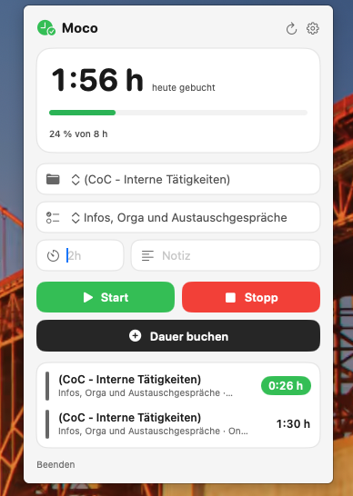
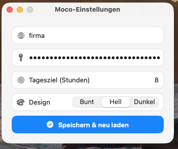
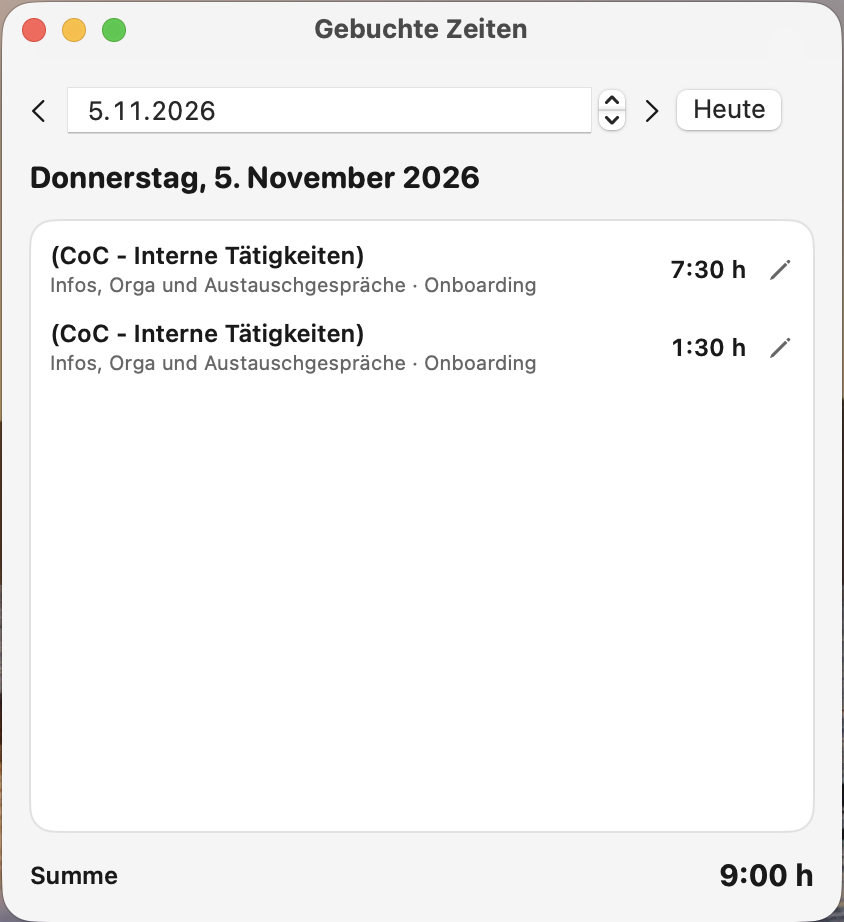
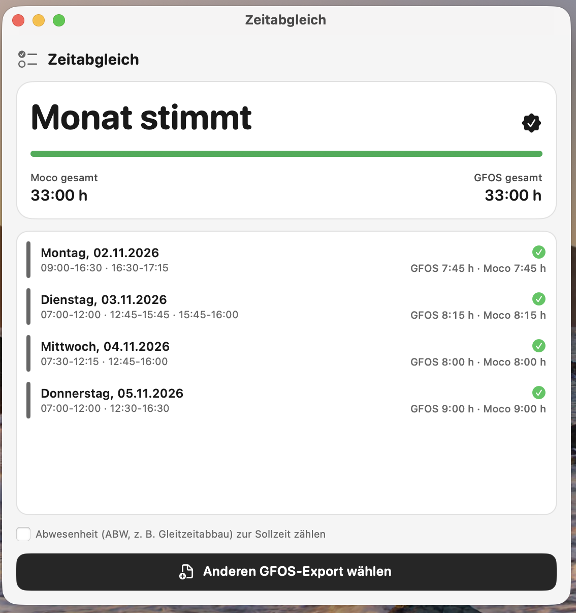

# MocoBar

Kleine macOS-Menüleisten-App, um Zeiten in [Moco](https://www.mocoapp.com) zu erfassen: Stoppuhr starten und stoppen, Dauern direkt buchen und den Tag auf einen Blick sehen.

> **Hinweis:** Dieses Projekt wurde vollständig von einem KI-Sprachmodell (LLM, GitHub Copilot) generiert. Es ist kein selbst geschriebener Code. Er wurde nicht umfassend geprüft oder getestet. Nutzung auf eigene Verantwortung.

## Funktionen

- **Start / Stopp:** startet bzw. stoppt die Moco-Stoppuhr für das gewählte Projekt und die gewählte Aufgabe.
- **Dauer buchen:** legt direkt eine Buchung für heute an. Eingaben wie `2h`, `1,5h`, `1:30`, `45m` oder `45` (Minuten) werden verstanden. Optional mit Notiz.
- **Tagesübersicht:** gebuchte Stunden heute (laufende Stoppuhr eingerechnet), Fortschritt zum Tagesziel (mit der Uhrzeit, zu der das Ziel erreicht ist: Restzeit plus der noch ausstehende Teil des Mittagsfensters, das du in den Einstellungen festlegst, standardmäßig 12:00–13:00. Stoppst und startest du die Stoppuhr in MocoBar mit mindestens 15 Minuten Abstand, gilt die Pause als gemacht und wird nicht mehr eingerechnet; nach Erreichen des Ziels die Überstunden des Tages, z. B. `+0:30 h`) und alle Buchungen des Tages.
- **Designs:** Bunt, Hell oder Dunkel, einstellbar in den Einstellungen.
- **Tagesziel:** in den Einstellungen frei wählbar (Standard 8 h).
- **GFOS-Abgleich:** Das Häkchen-Symbol im Kopfbereich öffnet ein Fenster „Zeitabgleich“. Dort wählst du den Monatsexport aus GFOS (`.xlsx`). Die App vergleicht pro Tag die Arbeitszeit (Zeilen vom Typ `LES`, optional plus Abwesenheit `ABW`) mit den in Moco gebuchten Stunden und markiert fehlende, zu wenige, zu viele oder nur in Moco vorhandene Buchungen. Zusätzlich werden die Gesamtstunden des Monats in Moco und GFOS immer angezeigt und verglichen: Stimmen sie überein, werden Abweichungen einzelner Tage ignoriert.
- **Neuer Tag:** Wechselt das Datum (z. B. über Nacht), lädt die Oberfläche automatisch neu.
- **Feierabend-Feier:** Sobald bei laufender Stoppuhr das Tagesziel erreicht ist, gibt es einmal pro Tag eine Benachrichtigung und Konfetti über den Bildschirm. Beim ersten Start fragt macOS nach der Erlaubnis für Benachrichtigungen.
- **Gebuchte Zeiten:** Das Kalender-Symbol im Kopfbereich öffnet eine Ansicht, in der du per Pfeilen oder Datumswähler beliebige vergangene Tage ansehen kannst (Buchungen mit Projekt, Aufgabe, Notiz, Tagessumme). Dauer und Notiz lassen sich dort ändern, Buchungen auch löschen (nicht bei laufender Stoppuhr).
- **Wochen- und Monatsübersicht:** Das Diagramm-Symbol zeigt die gebuchten Stunden und Tagesziele für die aktuelle oder eine vergangene Kalenderwoche bzw. einen Monat, inklusive Tagesaufschlüsselung und Soll-Ist-Abweichung.
- **Favoriten und Schnellstart:** Häufige Projekt-Aufgabe-Notiz-Kombinationen lassen sich merken und mit einem Klick als Stoppuhr starten. Über das Kontextmenü eines Favoriten kann er entfernt werden.
- **Sicherer API-Key:** Der API-Key wird im macOS-Schlüsselbund gespeichert. Ein bisher in den UserDefaults gespeicherter Schlüssel wird beim Start dorthin migriert und erst nach erfolgreicher Übernahme aus den UserDefaults entfernt.
- **Autostart:** Beim ersten Start wird MocoBar für den Login registriert. Der Schalter „Beim Login starten“ in den Einstellungen ändert das jederzeit.
- **Menüleisten-Icon:** aus mehreren Symbolen wählbar, optional mit der laufenden Zeit neben dem Icon.

## Screenshots

| Menüleisten-Popover | Einstellungen |
| --- | --- |
|  |  |

| Gebuchte Zeiten | Zeitabgleich |
| --- | --- |
|  |  |

## Voraussetzungen

- macOS 13 oder neuer
- Swift-Toolchain: entweder Xcode oder die Command Line Tools (`xcode-select --install`)
- Ein Moco-Account mit persönlichem API-Key

## Installation

```bash
git clone <repo-url> MocoBar
cd MocoBar
./build-app.sh
open MocoBar.app
```

Das Skript baut die App und erzeugt `MocoBar.app` (inklusive App-Icon) im Projektordner. Zum dauerhaften Nutzen:

1. `MocoBar.app` in den Ordner **Programme** ziehen.
2. Autostart wird beim ersten Start automatisch aktiviert (abschaltbar in den Einstellungen). Das funktioniert am zuverlässigsten, wenn die App in **Programme** liegt.

Beim ersten Start kann macOS die App blockieren, weil sie nur lokal (ad hoc) signiert ist. Dann Rechtsklick auf die App → **Öffnen**, oder unter **Systemeinstellungen → Datenschutz & Sicherheit** „Trotzdem öffnen“ wählen.

## Einrichtung

1. In der Menüleiste auf das Uhr-Symbol klicken, dann auf das Zahnrad.
2. **Moco-Domain** eintragen: nur der Teil vor `.mocoapp.com` (bei `https://firma.mocoapp.com` also `firma`).
3. **API-Key** eintragen. Du findest ihn in Moco unter **Profil → Integrationen**.
4. Optional Tagesziel, Design und Menüleisten-Icon einstellen.
5. Auf **Speichern & neu laden** klicken.

Danach erscheinen Projekt und Aufgabe zur Auswahl. Die letzte Auswahl wird gemerkt.

## Nutzung

| Aktion | Wie |
| --- | --- |
| Stoppuhr starten | Projekt und Aufgabe wählen, **Start** |
| Stoppuhr beenden | **Stopp** |
| Zeit nachtragen | Dauer eintippen (z. B. `2h`), optional Notiz, **Dauer buchen** |
| Vergangene Tage ansehen/bearbeiten | Kalender-Symbol im Kopfbereich |
| Wochen-/Monatsstunden ansehen | Diagramm-Symbol im Kopfbereich |
| Favorit starten | Schnellstart-Chip im Popover |
| Favorit speichern/löschen | „Auswahl merken“ bzw. Rechtsklick auf Favorit |
| Daten neu laden | Aktualisieren-Symbol im Kopfbereich |

## Technik

- Swift Package mit SwiftUI (`MenuBarExtra`), keine externen Abhängigkeiten.
- Moco-API v1 (`https://<domain>.mocoapp.com/api/v1`), Authentifizierung per API-Key:
  - `GET /activities` für die Buchungen des Tages
  - `GET /projects/assigned` für Projekte und Aufgaben
  - `POST /activities` zum Anlegen von Buchungen
  - `PUT /activities/{id}` und `DELETE /activities/{id}` zum Ändern und Löschen
  - `PATCH /activities/{id}/start_timer` und `/stop_timer` für die Stoppuhr
- Struktur: `Sources/MocoBar/`
  - `App.swift`: Menüleiste, Oberfläche, Einstellungsfenster
  - `Store.swift`: Zustand und Logik
  - `MocoClient.swift`: API-Aufrufe
  - `HistoryView.swift`: Ansicht „Gebuchte Zeiten“
  - `ReportsView.swift` / `TimeReport.swift`: Wochen- und Monatsübersicht
  - `KeychainStore.swift`: sichere Speicherung des API-Keys
  - `Celebration.swift`: Benachrichtigung und Konfetti
  - `Theme.swift`: Designs
- App-Icon: `Resources/AppIcon.icns` (Moco-Auge mit Codecamp-Wabe als Iris). Neu erzeugen mit `swift Resources/make-icon.swift`; `build-app.sh` kopiert es ins App-Bundle.

## Hinweise

- Domain und übrige Einstellungen liegen in den macOS-UserDefaults (`local.mocobar`); der API-Key liegt im macOS-Schlüsselbund.
- Die App nutzt Mocos Stoppuhr und Buchungen. Das Anwesenheits-Modul (Kommen/Gehen) von Moco wird nicht verwendet, da es nicht in jedem Account verfügbar ist.
